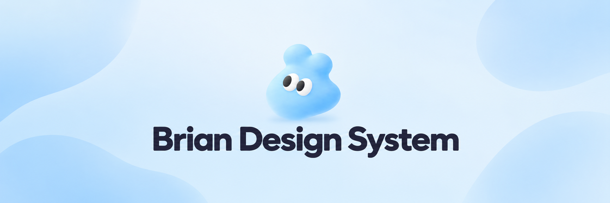

# Brian Design System

[English](README.md) | [한국어](README.ko.md)

[](https://swiftpackageindex.com/thebriancompany/swift-brian-ui/documentation)
[](https://swiftpackageindex.com/thebriancompany/swift-brian-ui)
[](https://swiftpackageindex.com/thebriancompany/swift-brian-ui)

A theme and UI component library for SwiftUI apps.



## Installation

- Swift tools 6.4 or later
- iOS 18 or later / macOS 15 or later

```swift
.package(url: "https://github.com/thebriancompany/swift-brian-ui.git", exact: "0.3.2")
```

## Documentation

- [API documentation (DocC)](https://thebriancompany.github.io/swift-brian-ui/0.3.2/documentation/brianui/)
- [Getting started and choosing components](Sources/BrianUI/BrianUI.docc/Articles/GettingStarted.md)
- [Themes and styles](Sources/BrianUI/BrianUI.docc/Articles/Theming.md)
- [Gradients and multicolor effects](Sources/BrianUI/BrianUI.docc/Articles/Gradients.md)
- [BrianSymbols icons](Sources/BrianUI/BrianUI.docc/Articles/Symbols.md)
- [Input and selection state](Sources/BrianUI/BrianUI.docc/Articles/Forms.md)
- [Alerts, bottom sheets, and menus](Sources/BrianUI/BrianUI.docc/Articles/Presentations.md)
- [AI usage guide](docs/AI_GUIDE.md)
- [Documentation guidelines and DocC builds](docs/DOCUMENTATION.md)

When building apps with AI, include `docs/AI_GUIDE.md` in the context.

## Showcase

- [BrianText on the App Store](https://apps.apple.com/app/id6833252823)
